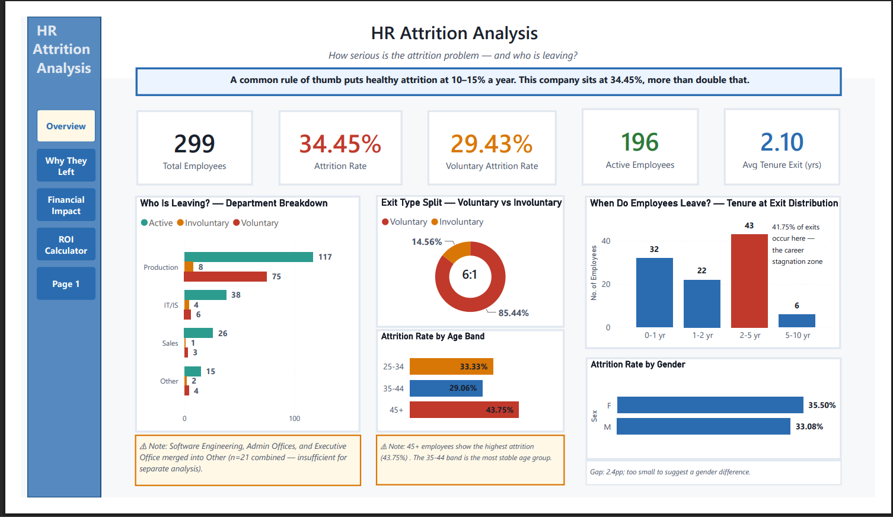
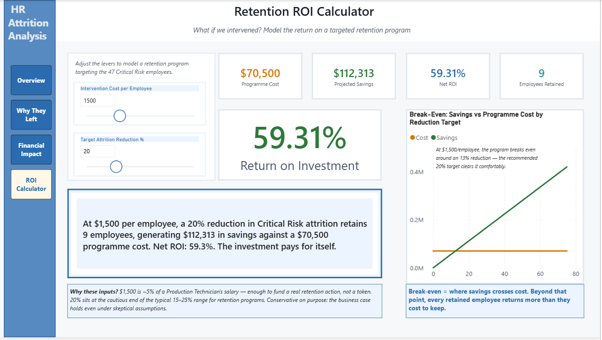
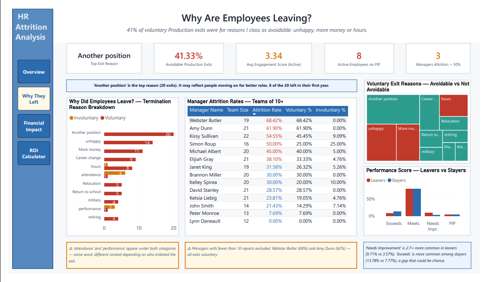
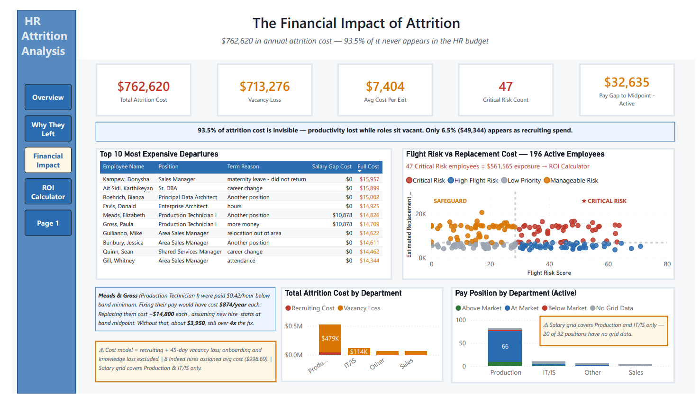

# HR Attrition Analysis: From Diagnosis to Decision

> **103 of 299 employees left. I traced who left and why, put a cost on those exits ($762,620), and built an interactive retention ROI tool.**
> Built end-to-end with Python, SQL and Power BI.



---

## The 30-Second Version

Of the 299 people in the data, **103 have left (34.45%)**, with exits dated 2010 to 2016. This project answers four questions a leadership team would ask:

| Question | Answer |
|---|---|
| **How bad is it?** | 34.45% of everyone employed has left; 85% of those exits were voluntary. Per year in post, the first year has the highest exit rate |
| **Why are they leaving?** | Top reason: another position (20). 41% of voluntary Production exits gave reasons I classed as avoidable: unhappy, more money, or hours |
| **What is it costing?** | $762,620 across the 103 exits ($7,404 each). 93.5% of that is output lost while roles sit empty |
| **What do we do?** | A $70,500 programme for the 47 Critical Risk employees models about **59%** ROI, if it cuts their leaving by 20% and all 47 would otherwise leave |

---

## The Headline Insight

**The cheapest fix in the data was a pay correction.**

Two Production Technicians who left were paid $0.42/hour below the band minimum. Lifting them to the minimum would have cost **$874 a year each**, every year. Replacing each one cost about **$3,900** once, in recruiting and vacancy, or about **$14,800** if the new hire starts at the band midpoint. (The data doesn't show that pay caused their exits: one left for another position, the other for more money.)

> **A note on rigour:** during dashboard QA I found a date-parsing bug. Two-digit birth years like 64 had been read as 2064, on 100 of the 310 records, giving impossible ages. A second check showed that measuring age on the 2019 snapshot made leavers look about 5 years older, so age is measured at hire. After both fixes the rates run 31–45% and don't rise or fall with age, and the two highest bands are the two smallest groups (42 and 34 people), so the project makes no age claim. [See the write-up in the notebook.](HR_Attrition_Analysis_python.pdf)

---

## Interactive ROI Calculator

The last page is a **What-If retention model**. Move two sliders (intervention cost and target reduction) and programme cost, modelled savings, exits avoided and net ROI all recalculate, along with a break-even chart.



> **The PDF and screenshots show the default values only.**
> **To use the live calculator, [download the `.pbix` dashboard file](#whats-in-this-repo) and open it in Power BI Desktop (free).**

**Recommended scenario: $1,500 per employee, 20% reduction.** Both are my own assumptions, not industry figures, and savings assume all 47 would otherwise leave. If only 34% of them left, as happened across the company over 2010–2016, the same spend would not pay back, so treat this as a case for a pilot, not a forecast. Modelled result: **about 9 exits avoided, $112,313 saved on a $70,500 spend, a 59% ROI.** The programme breaks even at a 12.55% reduction.

The dashboard opens on this scenario. The sliders let you test other cases: at $1,000 per head and a 25% reduction the model shows about 199%, which I treat as the optimistic end rather than the headline.

---

## More Views

<details>
<summary><b>Page 2: Why Are They Leaving?</b> (click to expand)</summary>



Termination reasons, performance ('Needs Improvement' is 2.7× as common among leavers: 9.71% vs 3.57%), and a manager table for teams of 10 or more, where three managers lost more than half their team (teams of 19–22, so a flag rather than proof).
</details>

<details>
<summary><b>Page 3: The Financial Impact</b> (click to expand)</summary>



The cost model, pay position for current staff, and a quadrant that ranks all 196 current employees by a flight-risk score (survey answers, plus pay for the 123 with a pay band) against replacement cost. 47 rank high on both: $561,565 in replacement exposure.
</details>

---

## How It Was Built

```
Raw CSVs  →  Python / pandas  →  DuckDB SQL  →  Power BI
 (4 files)     cleaning & QA      joins & analysis   dashboard
```

- **Python (pandas):** cleaned the four files (blank rows, trailing spaces, a wide-format cost file, dates) and fixed the birth-year bug
- **DuckDB SQL:** joined the HR file to the salary grid and recruiting costs, then attrition rates, the replacement-cost model and a weighted flight-risk score
- **Power BI:** 4-page dashboard with a live ROI calculator, custom theme and on-page data notes

---

## Limitations

- 34.45% and $762,620 cover every exit in the data (2010 to 2016). They are totals, not yearly figures.
- Vacancy loss assumes each role sits empty for 45 days, valued at salary. At 30 days the total would be about $525K. Onboarding and lost knowledge are left out.
- Cost per hire divides one year of recruiting spend by all hires since 2006, so it is likely understated.
- The salary grid matches 9 of 31 job titles (in Production, IT/IS and Admin Offices). 73 of the 196 current staff, including all of Sales and most of IT/IS, have no pay band.
- Flight-risk weights (engagement 50, satisfaction 30, pay 20) are a judgement call. Applied to people who already left, the score doesn't separate them from stayers (30.1 vs 29.6), so it ranks current staff rather than predicting exits.
- Projected savings apply the reduction to the full $561,565 exposure, which treats every Critical Risk employee as a leaver. If only 34% of them left, as happened over 2010–2016, the recommended scenario would not pay back.
- Leavers' review dates are blank, so when their engagement and ratings were recorded is unknown.
- `production_staff.csv` is cleaned in the notebook but not used in the analysis.

---

## What's in This Repo

| File | What it is |
|---|---|
| `HR_Attrition_Dashboard.pbix` | **The interactive dashboard. Download it to use the live ROI calculator** |
| `HR_Attrition_Dashboard.pdf` | Static preview of all 4 pages |
| `HR_Attrition_Analysis.ipynb` | Full Python + SQL pipeline, documented step by step |
| `HR_Attrition_Presentation.pptx` | Summary deck with recommendations |
| `/data/` | The four source CSV files |
| `/screenshots/` | Dashboard page images used in this README |

---

## Skills Demonstrated

`Data Cleaning` · `SQL (DuckDB)` · `Python / pandas` · `Cost Modelling` · `Risk Segmentation` · `Power BI` · `DAX` · `Data Storytelling`

---

*Dataset: HRDataset v13 (Kaggle).*
